<!-- 🌸 Jack Fang @LostJacks — keep-original-banner Sakura pixel edition -->
<!-- The original Sakura hero and falling-petals animation are preserved. Matching illustrated panels carry the theme through the whole README. -->

  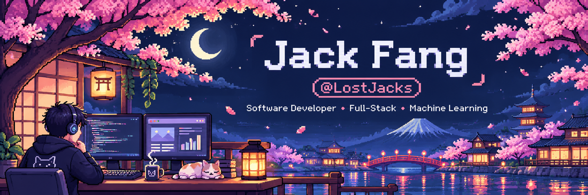
  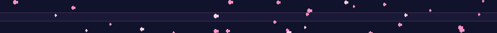
  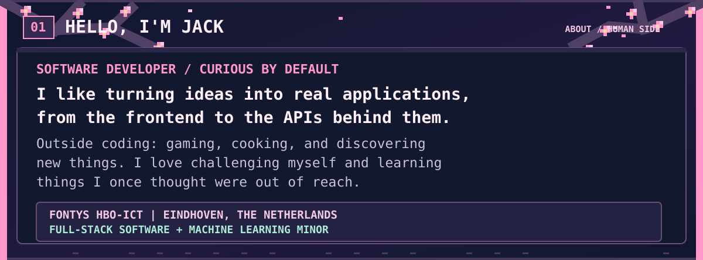
  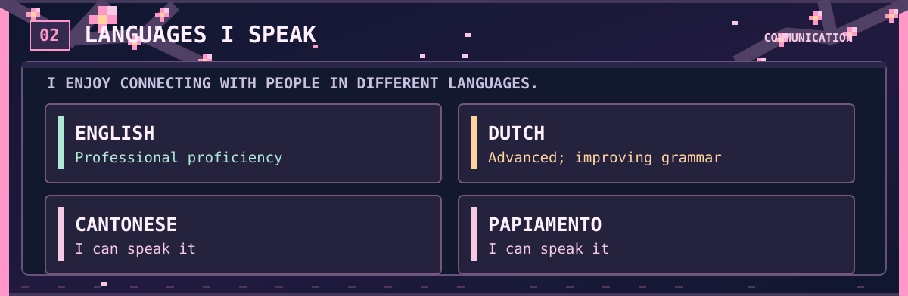
  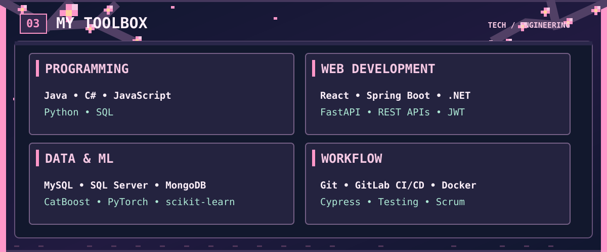
  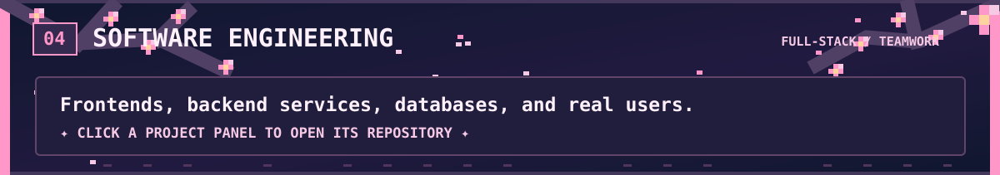
  <a href="https://github.com/LostJacks/Studyconnect-Backend">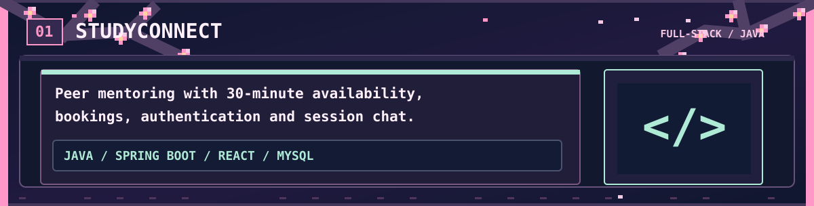</a>
  
<a href="https://github.com/LostJacks/Studyconnect-Backend"><b>StudyConnect backend</b></a> · <a href="https://github.com/LostJacks/studyconnect-frontend"><b>Frontend</b></a>

  <a href="https://github.com/LostJacks/Sioux-Frontend">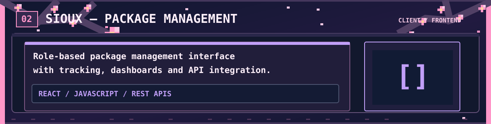</a>
  
<a href="https://github.com/LostJacks/Sioux-Frontend"><b>Sioux frontend repository</b></a>

  <a href="https://github.com/LostJacks/We-Code-For-Good">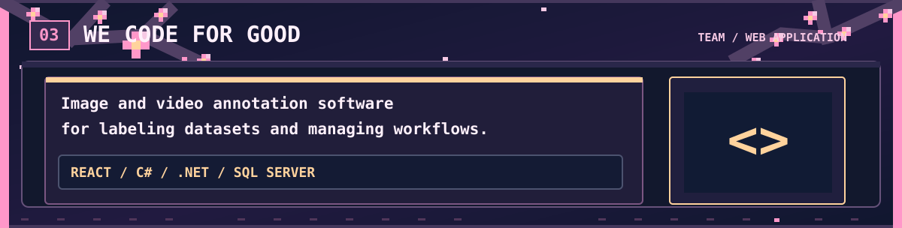</a>
  
<a href="https://github.com/LostJacks/We-Code-For-Good"><b>We Code for Good repository</b></a>

  <a href="https://github.com/LostJacks/Gathered-VS-2022">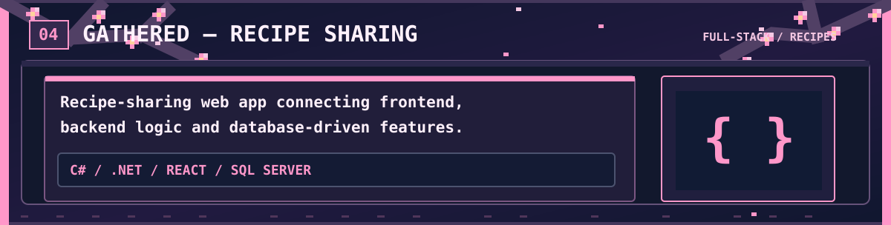</a>
  
<a href="https://github.com/LostJacks/Gathered-VS-2022"><b>Gathered repository</b></a>

  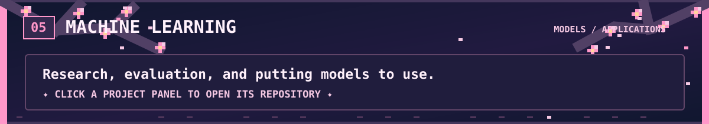
  <a href="https://github.com/LostJacks/League-Predictor">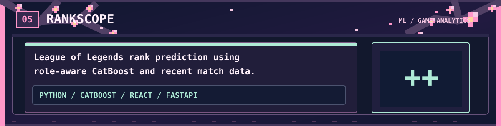</a>
  
<a href="https://github.com/LostJacks/League-Predictor"><b>RankScope model</b></a> · <a href="https://github.com/LostJacks/RankScope-Frontend"><b>Frontend</b></a>

  <a href="https://github.com/Samdatbenik/IBCS-detector-AI">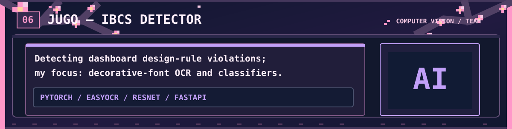</a>
  
<a href="https://github.com/Samdatbenik/IBCS-detector-AI"><b>Jugo team AI repo</b></a> · <a href="https://github.com/Samdatbenik/IBCS-detector-frontend"><b>Team frontend</b></a>

  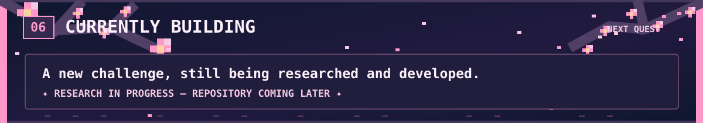
  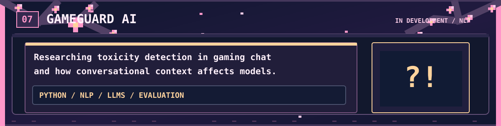
  
<i>GameGuard AI is in development. Repository not published yet.</i>

  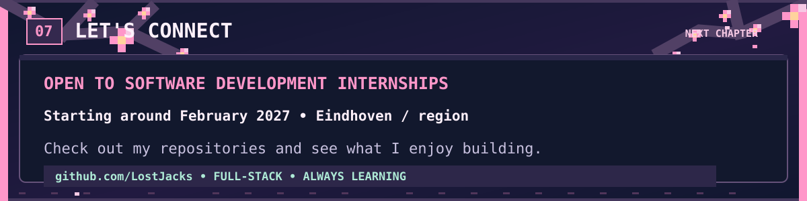
  
  
  ✿ Keep learning. Keep building. Make something you didn't think you could. ✿

<b>🌸 Read my introduction and project details as text</b>

### About me

Hey, I'm **Jack** — a software developer and Fontys HBO-ICT student based in Eindhoven. I enjoy building full-stack applications, exploring machine learning, and understanding how different pieces of software work together.

When I'm not coding, you'll probably find me **gaming, cooking, or discovering something new**. I enjoy challenging myself and learning things that I used to think were out of reach. That curiosity is one of the main reasons I love software development.

**Spoken languages:** English (professional proficiency); Dutch (advanced/conversational — still improving my grammar); Cantonese and Papiamento (I can speak both).

**Programming languages:** Java, C#, JavaScript, Python and SQL. **Other tools:** React, Spring Boot, .NET, FastAPI, MySQL, SQL Server, MongoDB, CatBoost, PyTorch, scikit-learn, Git, CI/CD and Docker.

### Software engineering

- **[StudyConnect backend](https://github.com/LostJacks/Studyconnect-Backend) / [frontend](https://github.com/LostJacks/studyconnect-frontend)** — built a peer mentoring platform with availability slots, booking workflows, authentication and real-time session messaging.
- **[Sioux Package Management](https://github.com/LostJacks/Sioux-Frontend)** — contributed a role-based React frontend with dashboards, package workflows and API integration.
- **[We Code for Good](https://github.com/LostJacks/We-Code-For-Good)** — collaborated on an image and video annotation platform, especially the React frontend and software design.
- **[Gathered](https://github.com/LostJacks/Gathered-VS-2022)** — recipe-sharing application demonstrating layered architecture and frontend/backend development.

### Machine learning

- **[RankScope model](https://github.com/LostJacks/League-Predictor) / [frontend](https://github.com/LostJacks/RankScope-Frontend)** — role-aware CatBoost rank prediction for League of Legends; 64.83% exact-rank accuracy in an evaluation of 617 players using 20-match median voting.
- **[Jugo IBCS Detector (team)](https://github.com/Samdatbenik/IBCS-detector-AI)** — dashboard rule detection; contributed to decorative-font detection through data preparation, OCR, image classification and integration.
- **GameGuard AI (in development)** — researching toxicity classification of gaming chat messages, including whether conversational context improves predictions. Its repository isn't published yet.

I'm currently looking for a **hands-on software development internship starting around February 2027**.

